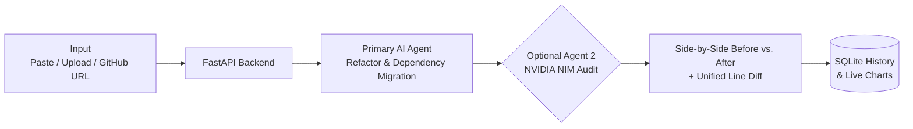

<div align="center">

# PPL: Please Patch Legacy

**An AI-Powered Autonomous Code Refactoring, Dependency Migration & Dual-Agent Audit Studio**  
*Styled after Rosaria's **Indenture** namecard from Genshin Impact.*


</div>

---

## Preview

<<<<<<< HEAD
> 
=======


>>>>>>> 27ffddeb795282daf82a4961777a01e6d61b7808

---

## Why I Built PPL

TBH, I built **PPL** to rescue myself from the pain of manually researching outdated library migrations, cleaning messy datasets, and dealing with brittle legacy code. It took over a month of trial, error, and questioning my life choices as someone new to fullstack development.

I started with one free AI model (*because nothing is free these days*), and after larping Instagram for a bit and got to know NVIDIA also had free developer models,so I hooked them in as an optional Second-Agent auditor. The visual theme is inspired by **Rosaria's *Indenture* namecard** (Genshin Impact), and the name **PPL** came Idk i found it funny, T~T

---

## How It Works



---

## Key Features

- **3 Ways to Load Legacy Code:** Paste code directly, drag-and-drop files (`requirements.txt`, `package.json`, `.py`, `.js`, etc.), or paste any **public GitHub file/repo URL** to browse and patch straight from GitHub.
- **16 Migration Presets:** Covers Python 2 → 3.12+, Flask → FastAPI + Pydantic v2, Django 5, Sync `requests` → Async `httpx`, Pydantic v1 → v2, SQLAlchemy 1.x → 2.0, Legacy JS → TypeScript, React Class → Hooks, Security Hardening, and more.
- **Dual-Agent Auditing:** Primary refactoring runs via the `google-genai` SDK (`gemini-4-hydrogen` with multi-key rotation), paired with an optional **Agent 2** security/logic auditor using NVIDIA NIM's free model catalog (DeepSeek, Qwen, Nemotron, Llama, Mistral).
- **Side-by-Side Diff & Confidence Gauge:** Synchronized Before vs. After panes, browser-side LCS line-by-line (`- / +`) diffing, breaking-change warnings, and 1-click file download.
- **SQLite Telemetry & Theme Switcher:** Persists every patch locally in SQLite (`refactoring_history.db`), renders live line-count and language charts, and lets you switch between **Rosaria (Indenture)**, **Bloodmoon Crimson**, and **Cathedral Rose (Light)**.

---

## Tech Stack

| Layer | Technology |
| :--- | :--- |
| **Backend** | Python 3, FastAPI, Uvicorn |
| **Primary AI Engine** | Official `google-genai` SDK (`gemini-4-hydrogen`) |
| **Optional Agent 2** | NVIDIA NIM OpenAI-compatible API (`build.nvidia.com`) |
| **Database** | SQLite (`sqlite3`) with automatic schema migration |
| **Frontend** | HTML5, Tailwind CSS (CDN), Vanilla JavaScript, Custom SVG Art |
| **Security** | `.env` via `python-dotenv`, strict GitHub-only URL allowlist |

---

## Run Locally

### 1. Clone the repository
```bash
git clone https://github.com/angiecodescode/PPL-Please-Patch-Legacy.git
cd PPL-Please-Patch-Legacy
```

### 2. Create & activate a virtual environment
**Windows (PowerShell):**
```powershell
python -m venv .venv
.\.venv\Scripts\Activate.ps1
pip install -r requirements.txt
```

**macOS / Linux:**
```bash
python3 -m venv .venv
source .venv/bin/activate
pip install -r requirements.txt
```

### 3. Add your API keys to `.env`
Copy `.env.example` to `.env` and fill in your keys:
```env
GEMINI_API_KEY=your_gemini_api_key_here
GEMINI_API_KEYS=
NVIDIA_API_KEY=
```
- Get a Gemini API key from **Google AI Studio**.
- *(Optional)* Grab a free `nvapi-...` key from **build.nvidia.com** for the live Agent 2 model catalog.

### 4. Launch the server
```bash
python -m uvicorn main:app --reload
```
Then open **`http://127.0.0.1:8000`** in your browser.

---

## Project Structure

```text
├── .env.example          # Safe environment variable template
├── .gitignore            # Protects .env, virtual environments, and local .db files
├── README.md             # Project documentation
├── requirements.txt      # Python dependencies
├── database.py           # SQLite storage, migrations, and analytics queries
├── main.py               # FastAPI server, AI orchestration, and GitHub URL importer
├── static/
│   └── app.js            # Client logic, LCS diffing, charts, and theme switcher
└── templates/
    └── index.html        # Rosaria-themed HTML + Tailwind CSS workbench
```

---

## Contributing

I'm new to fullstack development, so feedback, bug fixes, and new migration presets are super welcome! Feel free to open an issue, submit a PR, or just yap and advise on any flaws.
